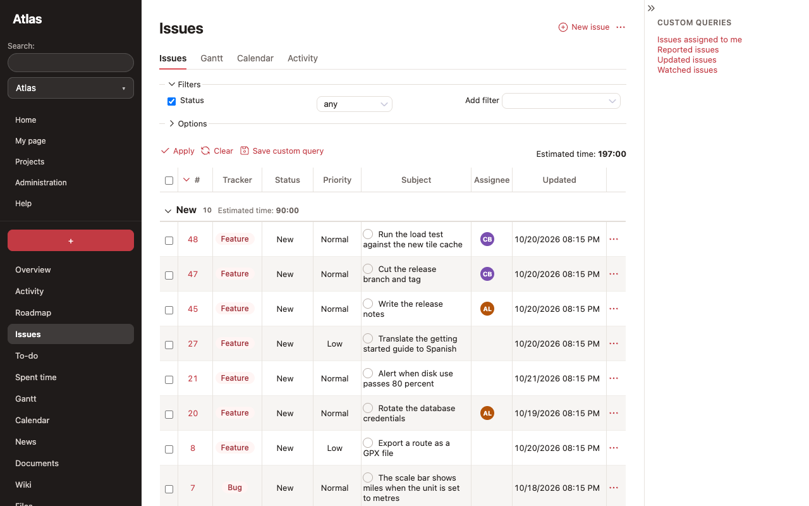
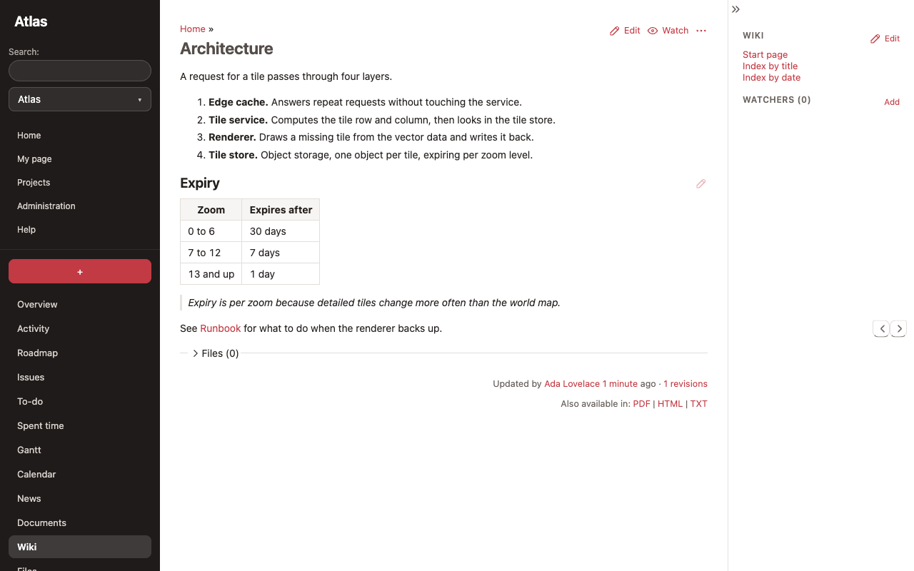
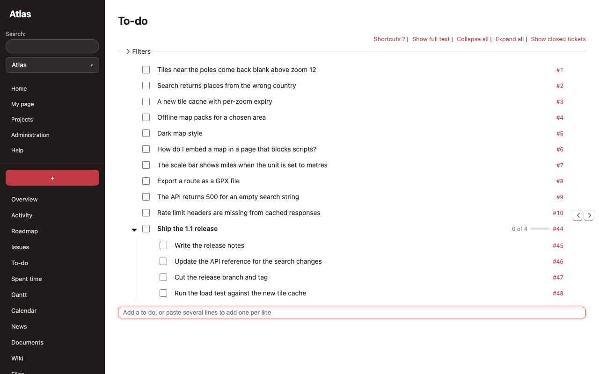
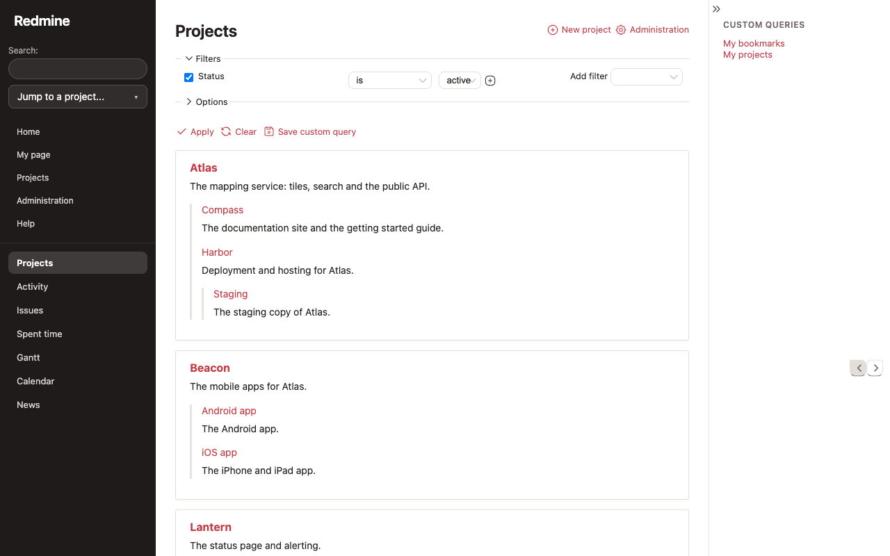
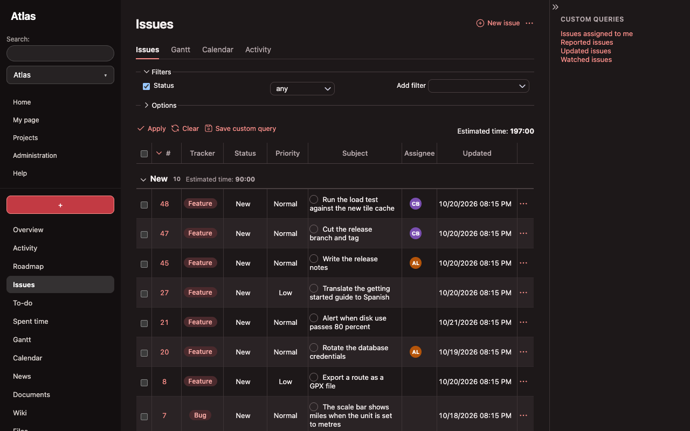
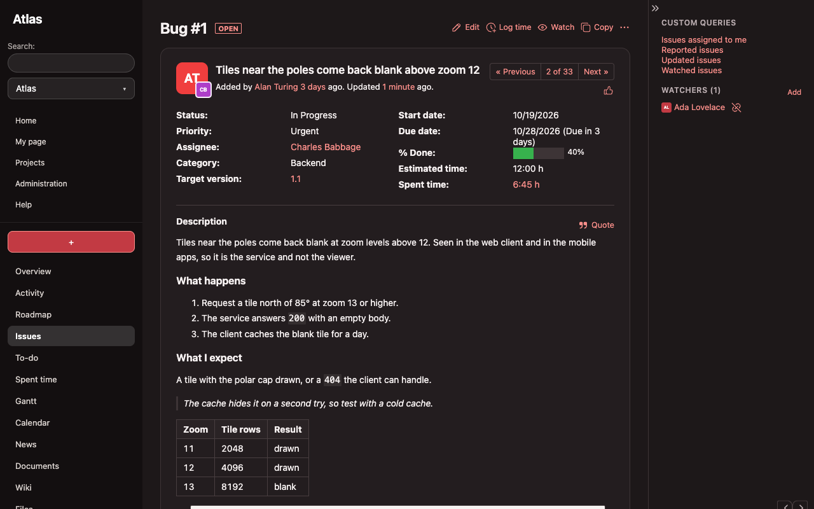

# Rubylode Morganite for Redmine

A light theme for Redmine 7 and up: warm neutrals, a coral accent and all navigation in a dark sidebar.

Redmine 7 takes its colours from variables, so a theme can restyle most of it by remapping them. Morganite is CSS plus one script (`javascripts/theme.js`, under 70 lines), with no plugin and no change to Redmine itself. The script only reads the page. It adds initials next to assignees, a chip around the tracker name and a row of view tabs. Without it the theme still works, with plainer lists.

Morganite is light first, with a dark set that follows your system setting (see [Dark mode](#dark-mode)).


| | |
|---|---|
|  |  |
|  |  |
|  |  |

Dark mode:

| | |
|---|---|
|  |  |

## Install

1. Download the zip attached to the latest release (the Releases page of this repository) and unzip it inside the `themes` folder of your Redmine, so that `themes/morganite/stylesheets/application.css` exists. Or copy the `morganite` folder from the source tree.
2. Restart Redmine.
3. In Administration, Settings, Display, choose **Morganite** as the theme and save.

To go back, choose another theme on the same page. Nothing is written to the database apart from that setting.

## What is covered

The header and menus, the sidebar, the issue list, the issue page with its history, the new and edit forms, buttons, flash messages, tables, tabs, the context menu and the login page, in light and dark. Gantt, calendar, wiki and administration take their colours from the same variables. I fix them as problems turn up.

## Dark mode

The dark set follows your system setting and is designed, not inverted. To keep the theme light, delete the `@media (prefers-color-scheme: dark)` block at the end of `morganite/stylesheets/application.css`. Every dark rule is in that block.

## Compatibility

Redmine 7.0 and newer. Tested on 7.0.2 and the 7.0 line. Older versions are not expected to work.

## Development

You need Docker, Ruby, Node and Chrome.

```
npm install
ruby bin/demo up        # a throwaway Redmine with demo data at http://localhost:3101 (admin / admin)
npm run check           # loads every page in light and dark, at desktop and phone width
npm run screenshots     # docs/screenshots
npm run record          # docs/demo, a GIF of a walk through the pages
ruby bin/demo reset     # wipe the demo
```

If the Rubylode to-do plugin is checked out next to this repository (`../redmine-rubylode-todo`, or set `TODO_PLUGIN_PATH`), the demo mounts it and the check, screenshots and recording include its page. Without it they skip that page.

The check fails on console errors, failed requests, sideways scrolling and text below WCAG AA contrast. `REDMINE_TAG=7.0 ruby bin/demo up` starts the demo on the 7.0 line instead of 7.0.2. Redmine caches theme files until it restarts, so after you change the stylesheet run `ruby bin/demo restart` and reload.

Pull Requests are welcome! Run `npm run check` first.

## Checks and releases

Every push starts a real Redmine from its Docker image (7.0.2 and the 7.0 line), loads every page of the theme in light and dark at desktop and phone width, and fails on the problems listed above. `.github/workflows/check.yml` does this on GitHub's runners, for pushes and pull requests. `.gitea/workflows/check.yml` is the same for a self-hosted Gitea. It runs on pushes to `main` only, because that runner works on the host with Docker access and should only run merged code.

A tag such as `v1.0.0` runs the check, builds `<name>-<version>.zip` holding the theme folder and attaches it to a release, with the matching section of `CHANGELOG.md` as the notes (`release.yml` in the same folders). The tag needs a section for that version in the changelog.

## License

GPL version 2 or later, the same as Redmine. See [LICENSE](LICENSE).

Copyright (C) 2026  Nick Gorbikoff

No warranty, as the GPL says. Try it on a copy of your tracker before the real one.

